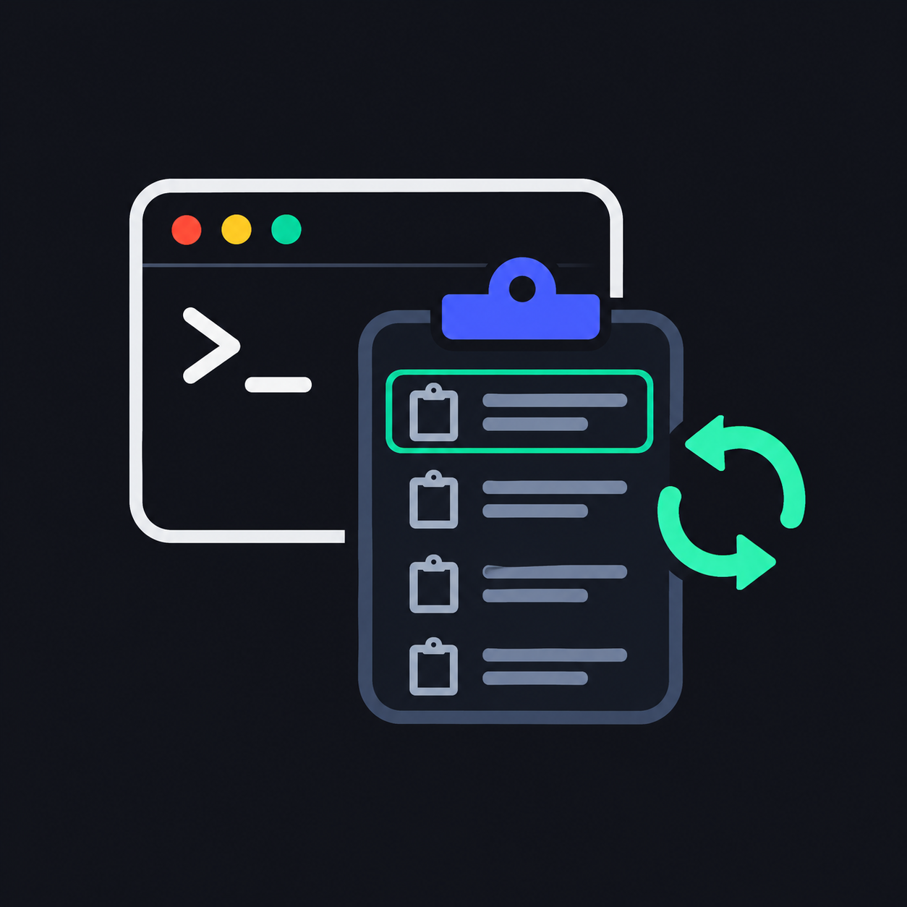

<p align="center">
  
</p>

<h1 align="center">clipwatch</h1>

<p align="center">
  Clipboard history for macOS, right inside a <a href="https://herdr.dev">herdr</a> popup.
</p>

<p align="center">
  
  
  
  
  <a href="LICENSE"></a>
</p>

---

## Features

- **Recent history**: keeps your last 100 copied texts.
- **Quick picker**: open it with one key from any herdr session, then choose an entry to put it back on the clipboard.
- **Privacy aware**: skips anything marked as concealed or transient by the source app, such as password managers ([nspasteboard.org](http://nspasteboard.org) markers).
- **Always on**: a per-user launchd agent keeps recording after herdr closes.
- **Light**: polls the clipboard every 300 ms, and never copies oversized entries into memory.

## Requirements

- macOS
- herdr ≥ 0.9.3
- Go
- Xcode Command Line Tools (`xcode-select --install`). herdr builds the plugin from source on install, and the build compiles a small Swift shim for AppKit.

## Install

```sh
herdr plugin install gusilva/clipwatch
```

Add a key to `~/.config/herdr/config.toml`:

```toml
[[keys.command]]
key = "prefix+shift+v"
type = "plugin_action"
command = "gusilva.clipwatch.open"
description = "clipboard history"
```

Then reload the config:

```sh
herdr server reload-config
```

The watcher starts the next time the herdr server starts.

## Usage

Press your key (`prefix+shift+v` in the example). The popup lists your history, newest first. Pick an entry to put it back on the clipboard.

The CLI also works on its own:

| Command                | What it does                                |
| ---------------------- | ------------------------------------------- |
| `clipwatch watch`      | Watches the clipboard and records history   |
| `clipwatch list`       | Prints the saved history                    |
| `clipwatch copy N`     | Puts entry `N` back on the clipboard        |
| `clipwatch pick`       | Opens the interactive picker                |
| `clipwatch open`       | Opens the picker popup in herdr             |
| `clipwatch agent`      | Installs the launchd watcher (run by herdr) |
| `clipwatch agent remove` | Stops and removes the launchd watcher     |

## How it works

A herdr startup hook installs a launchd agent (`~/Library/LaunchAgents/gusilva.clipwatch.watcher.plist`). The agent polls the clipboard and writes the history to herdr's state folder for the plugin. It keeps running when herdr is closed. macOS lists it under **System Settings → General → Login Items & Extensions**.

## Uninstall

```sh
herdr plugin action invoke gusilva.clipwatch.remove-watcher   # stops the watcher, deletes its plist
herdr plugin uninstall gusilva.clipwatch
```

Your history stays in `~/.local/state/herdr/plugins/gusilva.clipwatch/`. Delete that folder too if you want it gone.

## Development

Building from source, running locally, refreshing the binary herdr uses, and troubleshooting are covered in [docs/instruction.md](docs/instruction.md).

## License

[MIT](LICENSE)
